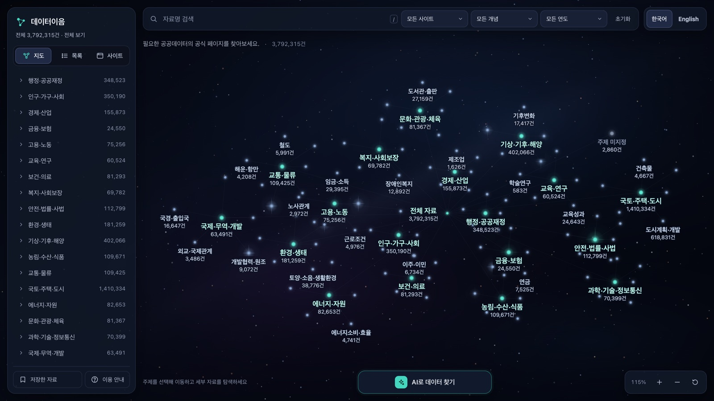
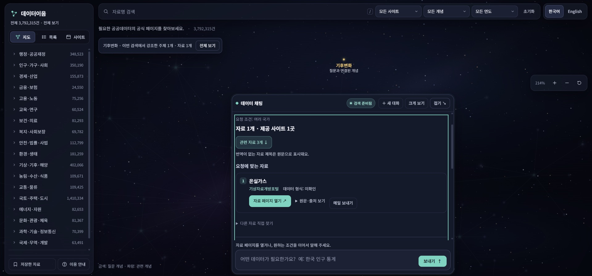
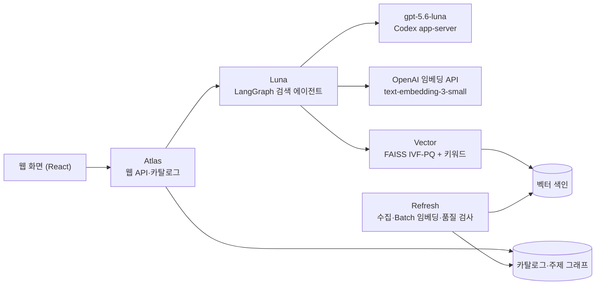

# 데이터이음 · Dataieum

**원본을 보관하지 않고, 의미로 연결한다.**

국내외 40개 공공데이터 포털에 흩어진 자료 약 379만 건의 메타데이터를 한곳에 모아, 질문 한 줄로 필요한 자료를 찾고 제공기관의 공식 페이지까지 안내하는 AI 에이전트입니다. Manzi팀이 (사)경남인공지능ICT협회가 주관한 [제4회 경남 AI·SW 경진대회](https://www.gnict.org/%EA%B2%8C%EC%8B%9C%ED%8C%90/sw%EA%B2%BD%EC%A7%84%EB%8C%80%ED%9A%8C/%EC%A0%9C4%ED%9A%8C-%EA%B2%BD%EB%82%A8aisw%EA%B2%BD%EC%A7%84%EB%8C%80%ED%9A%8C-%EA%B3%B5%EA%B3%A0/) AI Agent 부문에 출품해 **우수상**을 받았습니다.

> [!NOTE]
> 운영하던 서비스(`dataieum.com`)는 현재 운영하지 않습니다. 이 저장소는 운영 컨테이너에서 추출한 코드에 이미지 정의·프론트엔드 소스·테스트를 더한 공개 사본입니다. 실행에 필요한 카탈로그 DB, 임베딩, 벡터 색인은 들어 있지 않습니다.



<sub>운영 당시의 주제 연결 지도. 자료 3,792,315건이 18개 대주제와 그 아래 소주제로 이어져 있습니다.</sub>

## 무엇을 하나

- 해결하고 싶은 문제를 문장으로 물으면 국가·지역·연도·형식 같은 조건을 해석해, 뜻이 맞는 공식 자료를 찾습니다. 한국어로 물어도 해외 자료를 같은 기준으로 찾습니다.
- '경남 인구 통계'라고만 입력해도 대한민국·경상남도·인구라는 조건을 뽑고, 주제 지도에서 질문과 연결된 개념을 강조합니다. 함께 보면 좋은 지표도 이어서 제안합니다.
- '2020년만'처럼 이어 말하면 앞의 조건은 그대로 두고 다시 찾습니다.
- 결과는 항상 제공기관의 공식 페이지와 다운로드 경로로 연결합니다. 원본 파일은 보관하지 않습니다.



<sub>'지구 온난화의 원인'을 물었을 때. 지도에서 질문과 연결된 개념 '기후변화'가 금색으로 강조되고, 근거가 확인된 자료만 카드로 나옵니다.</sub>

## 왜 만들었나

공공데이터포털의 민간 활용(누적 다운로드·오픈API 활용 신청)은 2013년 말에서 2024년 말 사이 5,413배로 늘었고, 개방된 데이터 목록도 약 19배가 됐습니다. 그런데 자료를 찾는 방법은 그대로였습니다.

- **키워드 검색은 이미 아는 사람에게 유리합니다.** 관련 지표와 검색어를 알아야 원하는 자료에 닿습니다. 비전문가는 문제를 풀려면 어떤 데이터가 필요한지부터 판단하기 어렵고, 다른 분야에 있는 연관 자료는 더 놓치기 쉽습니다(O’Grady & Mangina, 2025).
- **LLM 검색은 몇 개만 보여 줍니다.** 6개 LLM 검색 엔진을 비교한 연구에서 답변당 인용 URL은 평균 4.3개로, 기존 검색(10.3개)의 절반에도 못 미쳤습니다(Zhang et al., 2025). 맞는 공식 자료가 수천 건이어도 몇 개로 줄어듭니다.
- **질문한 언어로 쏠립니다.** LLM은 질문과 같은 언어로 된 자료를 먼저 인용합니다(Sharma et al., 2025). 한국어로 물으면 해외 공식 통계가 뒤로 밀립니다.

그래서 목표를 이렇게 정했습니다. 질문한 언어나 출처의 유명세와 상관없이, 뜻이 맞는 공식 자료를 빠짐없이 찾아 공식 경로로 연결한다.

## 어떻게 만들었나

### 1. 단어 대신 의미로: 비교 실험에서 출발했습니다

처음에는 포털이 붙인 태그를 주제에 대응시키는 규칙과 BM25로 자료를 분류했습니다. 그런데 같은 단어가 다른 뜻으로 쓰이거나, 다른 단어가 같은 뜻을 가리키는 경우를 계속 구별하지 못했습니다. 그래서 운영 데이터에서 무작위로 뽑은 자료를 서비스와 같은 101개 주제 정의에 BM25와 임베딩으로 각각 분류해, 같은 조건에서 비교했습니다.

| | BM25 | 임베딩 |
| --- | ---: | ---: |
| 분류하지 못한 비율 | 6.8% | 0.1% |
| 두 방법의 답이 갈린 자료의 정답률 | 19% | 62% |

BM25가 분류하지 못한 자료는 주제 정의와 겹치는 단어가 하나도 없었고, 중국어·일본어 자료는 97.3%를 분류하지 못했습니다. 답이 갈린 자료는 어느 방법이 낸 답인지 가린 채 판정했습니다.

이 결과로 가설을 세웠습니다. 공공기관이 작성한 제목·설명·공식 태그는 그 자료가 무엇인지 알려 주는 1차 근거입니다. 원본을 읽지 않고도 이 메타데이터를 다국어 임베딩해 주제 정의나 질문과의 의미 거리를 재면, 언어가 달라도 분류하고 찾을 수 있다는 것입니다. 이 가설을 입력이 충분한가, 작은 모델로 충분한가, 유사도로 주제가 나뉘는가라는 세 전제로 나눠 차례로 확인했습니다. 아래 2~4가 그 과정입니다.

수집과 검색의 원칙도 이때 정했습니다.

- **보관하지 않고 연결합니다.** 메타데이터와 공식 페이지·다운로드 경로까지만 저장합니다.
- **공식 자료 1건은 1항목입니다.** API의 기능이나 응답 필드로 건수를 부풀리지 않습니다.
- **정확한 조건은 필터로 거릅니다.** 연도·지역·기관은 임베딩이 아니라 정확 일치로 처리합니다.
- **규칙으로 확정되는 일은 코드가, 예외만 LLM이 맡습니다.**

### 2. 입력이 충분한가: 짧은 자료를 자르지 않고 문맥을 채웠습니다

먼저 모든 자료의 임베딩 입력을 실제 토크나이저로 셌습니다. 중앙값 97토큰, 평균 179토큰, 왜도 +1.61로 크게 치우친 분포여서 평균이 아니라 백분위로 판단했습니다. 짧은 구간은 사이트별로 직접 열어 보고 일부는 원본 API와 대조했는데, '산업별 취업자'(21토큰)처럼 짧아도 정상인 통계가 대부분이었습니다.

짧은 자료의 69%는 KOSIS 통계표였습니다. 일반 포털은 문맥을 설명에 쓰지만, KOSIS는 같은 문맥을 분류 경로에 담고 있었습니다.

| 출처 | 제목 | 문맥이 담긴 곳 |
| --- | --- | --- |
| 일반 포털 | 고양시 산업별 취업자 | 설명: 고양시의 산업별 취업자 수를 집계한 통계 |
| KOSIS | 산업별 취업자 | 분류 경로: 고양시기본통계 > 노동 |

그래서 길이로 자르는 대신 문맥을 채우기로 했습니다. 입력을 제목 + 설명 + 공식 태그 + 공식 분류 경로로 구성하자 KOSIS에서 64토큰 이하인 자료가 99.3%에서 0.5%로 줄었습니다. 길이 하위 5%를 잘라냈다면 KOSIS 자료의 51.5%를 잃었을 겁니다. 이 입력은 [`embedding_batch.py`의 `input_text()`](embedding_batch.py#L42)가 만들며, 분류 경로와 조사명을 `Context` 줄로 덧붙입니다.

### 3. 작은 모델로 충분한가: 성능표가 아니라 우리 데이터와 비용으로 골랐습니다

모델을 고를 때 원칙은 세 가지였습니다. 성능은 범용 점수가 아니라 우리 데이터로 확인한다. 한 번이 아니라 매일 갱신해도 감당할 수 있는 비용이어야 한다. 서버 자원은 검색에만 쓴다.

| | text-embedding-3-small (채택) | text-embedding-3-large | BGE-M3 (로컬) |
| --- | ---: | ---: | ---: |
| 벡터 차원 | 1,536 | 3,072 | 1,024 |
| 전체 임베딩 비용 | $6.83 | 약 $44 | 별도 GPU 서버 필요 |
| 벡터 원본 용량 | 23.3GB | 46.6GB | 15.6GB |
| Kor-IR NDCG@10 (범용 평가) | 56.3 | 73.7 | 79.4 |

범용 한국어 검색 점수만 보면 대형 모델과 로컬 모델이 앞섭니다. 하지만 공공 메타데이터는 규격화된 행정·통계 용어로 쓰여 있어 신조어나 긴 문맥을 추론할 일이 드뭅니다. 그 격차가 우리 데이터에서도 나타나는지 14개 출처의 표본으로 직접 확인했습니다. 작은 모델로 잰 자료–주제 평균 최고 유사도는 한국 공공데이터포털(0.385)과 KOSIS(0.380)가 가장 높았고, 오스트리아(0.356)와 일본(0.352)이 뒤를 이었으며, 호주(0.266)가 가장 낮았습니다. 서비스의 중심인 한국 자료가 주제와 가장 분명하게 가까웠습니다. 정확도를 좌우한 것은 모델 크기보다 입력이었고, 앞에서 본 분류 경로 한 필드가 그 예입니다.

그 결과 실측 입력 6.83억 토큰을 Batch API로 약 28시간, $6.83에 임베딩했습니다. 대형 모델의 6분의 1 수준입니다. 이후 매일 갱신할 때는 입력이 바뀐 자료만 다시 임베딩해 기존 벡터의 92%를 재사용했고, 새로 드는 비용은 하루 $0.018 정도였습니다.

- Batch 제출과 결과 회수: [`embedding_batch.py`](embedding_batch.py)
- 자료 ID와 입력 해시가 같으면 기존 벡터 재사용: [`operations/refresh_batch.py`](operations/refresh_batch.py)
- 하루 임베딩 예산 상한($0.10)과 출처 순환(하루 8곳): [`operations/refresh-sources.json`](operations/refresh-sources.json), [`operations/refresh_state.py`](operations/refresh_state.py)

### 4. 유사도로 나뉘는가: 주제를 단어가 아니라 정의로 세웠습니다

주제를 키워드 목록으로 만들면 단어만 같은 자료가 딸려 옵니다. '예산, 결산, budget…'으로 만든 주제에는 'Carbonate budget(탄산염 수지)'까지 끌려옵니다. 그래서 101개 소주제마다 한국어와 영어로 사전식 정의를 쓰고, 그 정의문을 임베딩했습니다.

> **예산·결산** — 일정 기간의 수입과 지출을 미리 정한 계획 및 그 집행 결과를 확정한 계산<br>
> **Budget and Accounts** — A planned statement of public revenue and expenditure and the final account of its execution

이렇게 하면 '공공의 수입·지출'이라는 뜻 자체와 비교하게 되고, 영어 정의 덕분에 해외 자료도 같은 기준으로 연결됩니다. 주제의 구조도 함께 정리했습니다.

- '행정·공공재정' 같은 18개 대주제는 넓은 단어끼리 서로 가까워 경계가 흐려지므로, 임베딩하지 않고 소주제를 묶는 데만 씁니다.
- 계층과 연관을 구분했습니다. 강수는 농업과 '관련'되지만 농업의 '하위'는 아닙니다(SKOS). '통계·지도'는 주제가 아니라 형식입니다(DCAT).

어디까지를 연결로 볼지는 전체 점수 분포를 그려 보고 구간마다 표본을 직접 읽어서 정했습니다. 운영 데이터 전체에 적용한 결과는 다음과 같습니다.

| 자료의 최고 유사도 | 구분 | 비율 |
| --- | --- | ---: |
| 0.25 이상 | 고신뢰 | 81.7% |
| 0.15 이상 0.25 미만 | 저신뢰 | 18.2% |
| 0.15 미만 | 미분류 | 0.1% |

여러 주제에 걸친 자료는 최고점 대비 비율 4가지와 하한 3가지, 모두 12개 조합을 무작위 표본에 적용해 비교했습니다. 최고점의 80%까지 연결하면 자료의 48%가 주제 4개 이상에 붙어 지도가 뭉개졌습니다(자료당 평균 4.18개). 85%면 2.94개, 95%면 1.40개였고, 최고점의 90% 이내만 연결하는 기준을 골라 자료당 평균 2.0개 주제로 정리했습니다. 이 기준은 [`discovery_harness/topic_graph.py`](discovery_harness/topic_graph.py#L22)의 `THRESHOLDS`와 발행 단계의 [`operations/refresh_publish_data.py`](operations/refresh_publish_data.py#L95)에 그대로 들어 있습니다.

### 5. 얇은 에이전트: LLM은 질문당 두 번만 판단합니다


에이전트는 일부러 얇게 만들었습니다. LLM은 질문에서 조건을 뽑을 때와 검색된 후보에서 근거를 고를 때, 두 번만 씁니다. 검색·정렬·필터·링크 확인처럼 정답이 정해진 일은 토큰이 들지 않는 코드가 맡습니다. LLM에게 글을 쓰게 하지 않고 번호로 고르게만 하니 경량 모델로도 충분했고, 운영 비용도 낮게 유지됐습니다.

- **LLM은 링크를 만들지 않습니다.** 결과에 나오는 링크는 모두 수집 단계에서 확보한 공식 경로입니다. LLM이 고른 근거 번호는 서버가 원문 메타데이터로 되돌려 다시 확인합니다([`vector_judge.py`](discovery_harness/vector_judge.py)).
- **별도의 Vector DB 서버 없이 앱 안에서 검색합니다.** FAISS IVF-PQ로 벡터 1개를 6,144바이트에서 96바이트로(64분의 1) 압축해, 전체 23.3GB를 약 0.4GB로 줄였습니다. 압축 색인으로 후보를 찾은 뒤 상위 후보는 원본 벡터로 점수를 다시 계산합니다([`vector_index.py`](discovery_harness/vector_index.py)).
- **색인은 갱신할 때마다 새로 만듭니다.** 자료가 하루 한 번 바뀌므로 매번 다시 지어 카탈로그와 항상 일치시킵니다.
- **키워드 후보는 RRF로 벡터 결과와 합칩니다**([`hybrid_search.py`](discovery_harness/hybrid_search.py)).

단계들은 LangGraph 그래프로 이어져 있습니다([`experiments/site_workflow.py`](experiments/site_workflow.py)). 조건 추출 지시문은 [`intent_instructions.txt`](discovery_harness/intent_instructions.txt), 근거 판정 지시문은 [`discovery_harness/skills/`](discovery_harness/skills)에 있습니다.

### 6. 링크와 메타데이터: 근거가 확인된 것만 지웠습니다

결과가 실제 공식 자료로 이어지는지 확인하려고 수집한 공식 페이지 전체에 접속해 검사했습니다. 화면만으로 판단할 수 없는 77.0%(빈 본문이나 JS로 그리는 페이지, 미국 자료)는 공식 메타데이터와 대조했고, 남은 1.5%의 예외는 기계로 다시 검사했습니다. 끝까지 판단이 남은 0.89%는 LLM(33%)과 기계 검사(67%)로 나눠 결론을 냈습니다.

LLM 판정만으로는 아무것도 지우지 않았습니다. LLM이 메타데이터 동일성을 판정한 결과는 같은 의미 62.7%, 연도·범위 차이 35.2%, 다른 주제 1.5%, 근거 부족 0.6%였고, 범위 차이와 다른 주제는 교정 후보로 남겼습니다. 삭제한 것은 공식 목록에서 다시 찾아도 없고 대체 경로도 없는 0.67%뿐입니다. 접속에 실패했다는 이유만으로 자료가 사라졌다고 단정하지 않기 위해서입니다.

링크·메타데이터 검사는 [`operations/refresh_quality.py`](operations/refresh_quality.py), 공식 목록과의 대조는 [`collection_audit.py`](collection_audit.py)가 맡습니다.

## 운영 결과

- 국내외 공식 포털 40곳, 자료 3,792,315건을 한 번에 검색
- 자료의 81.7%가 고신뢰 구간으로 주제에 연결, 자료당 평균 2.0개 주제
- 전체 임베딩 $6.83(약 28시간), 매일 갱신 때는 기존 벡터 92% 재사용(신규 비용 하루 $0.018)
- 벡터 색인 23.3GB → 약 0.4GB, 별도 Vector DB 없이 검색
- 질문당 LLM 판단 2회, LLM이 만든 링크 0개
- 자동화 테스트를 통과한 이미지만 서버에 배포

## 남은 과제와 다음 단계

남은 과제는 이렇습니다.

- 지금의 신뢰 구간은 유사도 점수에 기댑니다. 판정 표본으로 보정해 정답 표본 기반의 정확도 지표로 바꿔야 합니다.
- 천문·지질·역사처럼 주제표가 얇은 영역은 소주제를 보강해야 합니다. EU·호주 자료의 비중이 높은 영역입니다. 유사도 0.2 미만인 자료(전체의 2.3%)를 군집화해 약한 주제를 찾는 데서 시작할 계획이었습니다.
- 메타데이터를 근거로 안내하므로, 실제 수치와 최신성은 연결된 공식 출처에서 확인해야 합니다.
- 경상남도와 시군 포털은 아직 수집 대상에 들어 있지 않습니다.

다음 단계로는 두 가지를 계획했습니다.

- **경남 특화**: 경상남도와 18개 시군 포털을 연계해, 도정 업무에 쓰는 '정책 근거자료 찾기'를 제공합니다.
- **에이전트 확장**: MCP·API로 공개해 다른 AI 에이전트가 공공데이터 검색 도구로 쓸 수 있게 합니다.

## 시스템 구성

운영 서비스는 네 가지 컨테이너로 나뉘어 있었습니다. 이미지 정의는 [`Dockerfile`](Dockerfile)에 있습니다.



| 이미지 | 하는 일 | 주요 코드 |
| --- | --- | --- |
| `atlas` | 웹 화면과 API, 카탈로그 조회 | [`dataieum.py`](discovery_harness/dataieum.py), [`http_api.py`](discovery_harness/http_api.py), [`catalog_worker.py`](discovery_harness/catalog_worker.py) |
| `luna` | 질문 해석, 검색, 근거 판정 | [`luna_discovery.py`](experiments/luna_discovery.py), [`site_workflow.py`](experiments/site_workflow.py), [`vector_judge.py`](discovery_harness/vector_judge.py) |
| `vector` | 벡터·키워드 혼합 검색 | [`vector_server.py`](discovery_harness/vector_server.py), [`vector_index.py`](discovery_harness/vector_index.py), [`hybrid_search.py`](discovery_harness/hybrid_search.py) |
| `refresh` | 출처 수집, 바뀐 자료만 임베딩, 품질 검사 | [`refresh.py`](operations/refresh.py), [`refresh_batch.py`](operations/refresh_batch.py), [`refresh_quality.py`](operations/refresh_quality.py) |

갱신은 systemd 타이머 두 개로 돌아갑니다. [`dataieum-refresh.timer`](operations/dataieum-refresh.timer)는 매시간 임베딩 Batch를 정산하고, 40개 출처를 하루 8곳씩 돌아가며 수집합니다. [`dataieum-maintenance.timer`](operations/dataieum-maintenance.timer)는 매일 04:00(KST)에 준비된 변경분을 카탈로그·키워드 색인·FAISS 색인·주제 그래프에 발행하고, 발행이 중간에 멈추면 기록해 둔 되돌리기 정보로 복구합니다.

## 저장소 구성

| 경로 | 내용 |
| --- | --- |
| `discovery_harness/` | 세 서비스가 함께 쓰는 패키지: API, 검색 도구, 벡터 색인, 판정 계약, 정적 웹 자원 |
| `experiments/` | Luna 실행부와 LangGraph 검색 워크플로 |
| `embedding_batch.py` | 임베딩 입력 구성과 OpenAI Batch 제출 |
| `classification_batch.py`, `confidence_graph.py` | 주제에 연결되지 않은 자료의 배치 분류, 신뢰도 그래프 |
| `catalog.py`, `registry.py`, `collectors.py`, `collection_audit.py` | 카탈로그 저장, 40개 출처 정의, 수집기, 공식 목록 대조 |
| `operations/` | 매일 갱신과 발행, 백업·배포 스크립트, systemd 단위, 테스트 |
| `frontend/` | 운영 컨테이너에 실린 빌드 결과(Atlas가 그대로 제공) |
| `frontend-src/` | `frontend/`를 만드는 React·TypeScript 소스 |
| `Dockerfile` | atlas·vector·refresh·luna 이미지 정의 |

## 직접 확인하기

```bash
python3.13 -m venv .venv && . .venv/bin/activate
pip install -r requirements.txt
PYTHONPATH=.:operations python -m unittest discover -s operations/tests -t operations/tests
PYTHONPATH=.:operations python -m unittest operations/test_cleanup.py
```

테스트는 모두 143개이고, PostgreSQL이 필요한 1개는 `TEST_POSTGRES_DSN`을 지정했을 때만 실행됩니다. 색인 발행 테스트(`test_refresh_publish.py`의 9개)는 운영 서버와 같은 리눅스 환경(GNU `cp`, URI를 지원하는 SQLite)을 전제로 하므로 macOS에서는 오류로 끝납니다. Python 버전은 운영 이미지와 같은 3.13에 맞췄습니다.

프론트엔드는 `frontend-src/`에서 빌드하며, 결과물은 `frontend/`와 같은 파일입니다.

```bash
cd frontend-src
npm ci && npm run build
for t in tests/*.mjs; do node --experimental-transform-types "$t"; done
```

서비스 전체를 띄우려면 카탈로그 DB, 임베딩, 벡터 색인이 필요하지만 이 저장소에는 포함하지 않았습니다.

## 이 저장소가 만들어진 방식

운영 중이던 atlas·luna·vector 컨테이너에서 코드를 그대로 추출했고, 파일마다 추출 원본과 공개본의 SHA-256을 [`SOURCE_MANIFEST.json`](SOURCE_MANIFEST.json)에 남겼습니다. 컨테이너에 들어 있지 않던 이미지 정의, 프론트엔드 소스, 테스트, 서버 타이머는 개발 저장소에서 가져왔습니다. 프론트엔드 소스는 빌드 결과가 `frontend/`와 바이트 단위로 같은 리비전을 골랐습니다. 공개하면서 바꾼 부분(서버 접속 정보를 환경변수로 분리한 것 등)과 가져오지 않은 파일은 [`PUBLIC_EXPORT_NOTES.md`](PUBLIC_EXPORT_NOTES.md)에 정리했습니다.

## 사용한 도구와 참고 자료

- **AI·도구**: text-embedding-3-small, gpt-5.6-luna, Codex, Claude Code, LangGraph, FAISS, PostgreSQL, React
- **데이터**: 국내외 40개 공공데이터 포털의 공개 메타데이터
- **참고 문헌**
  - 행정안전부, 「공공데이터 개방 현황」, 2024.12. 기준
  - O’Grady & Mangina (2025), *Universal Access in the Information Society*
  - Zhang et al. (2025), 6개 LLM 검색 엔진 비교 분석
  - Sharma et al. (2025), "Faux Polyglot", NAACL 2025
- 프론트엔드 번들에 포함된 오픈소스 고지: [`THIRD_PARTY_NOTICES.md`](THIRD_PARTY_NOTICES.md)
