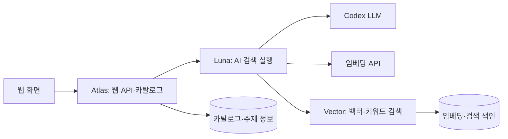

# 데이터이음 · Dataieum

**공공데이터를 자연어로 검색하고, 관련 자료와 공식 원문까지 연결하는 AI 에이전트입니다.**

- **운영 상태: 현재 서비스 운영 중단.** 이 저장소는 개발한 코드와 설계를 보존하는 공개 소스 저장소입니다. 기존 임베딩 DB는 삭제되었으며, 실행에 필요한 카탈로그 DB·임베딩 DB·벡터 인덱스는 포함하지 않습니다.
- **수상: 제4회 경남 AI·SW 경진대회 우수상.** [대회 공고](https://www.gnict.org/게시판/sw경진대회/제4회-경남aisw경진대회-공고/)
- 이전 서비스 주소: `dataieum.com`

사용자가 찾고 싶은 자료의 목적과 조건을 입력하면 AI가 검색 계획을 구성합니다. 검색 도구가 반환한 실제 후보를 검토하여 요청에 직접 맞는 자료와 함께 살펴볼 관련 자료를 구분하고, 자료 설명·제공기관·원문 링크를 보여줍니다. 연결 지도와 후속 질문으로 탐색을 이어갈 수 있습니다.

## 주요 기능

- **자연어 검색**: 질문에서 목적·국가·지역·기간 등의 조건을 해석합니다.
- **자료 검색과 추천**: 임베딩·키워드 검색, 후보 관련성 판단, 동일 계열 자료의 반복 노출 정리를 수행합니다.
- **연결 탐색**: 자료–주제 관계와 관련 개념을 따라 다른 자료를 찾습니다.
- **후속 질문과 작업 관리**: 이전 검색 조건의 변경사항을 반영하고 완료·취소·실패 상태를 관리합니다.
- **원문 안내**: 제공기관의 공식 페이지와 다운로드 경로를 제공합니다. 파일 다운로드와 이용조건 확인은 제공기관 페이지에서 진행합니다.

## 임베딩을 사용한 이유

공공데이터를 찾는 사람은 자신이 해결하려는 문제를 알고 있어도, 각 기관이 붙인 자료명이나 분류명을 모두 알기는 어렵습니다. 같은 관심사를 다루는 자료도 기관마다 다른 용어와 설명을 사용할 수 있습니다. 예를 들어 사용자는 ‘노년층 돌봄’을 묻지만 자료명에는 ‘고령자 복지시설’이라는 표현이 들어갈 수 있습니다. 이런 표현 차이를 넘어 관련 후보를 찾는 것이 임베딩을 도입한 이유입니다.

임베딩은 텍스트의 의미를 수치 벡터로 표현합니다. 데이터이음은 **질문·자료 설명·주제 정의를 같은 모델로 표현하고, 그 사이의 유사도를 탐색에 활용**합니다. 사용자가 공식 자료명을 정확히 입력하지 않아도 의미가 가까운 후보를 찾아 검토하고, 자료가 어떤 주제들과 연결되는지도 살펴볼 수 있도록 한 구조입니다.

### 검색을 넘어 자료와 주제를 연결하기 위해

기관별 분류는 해당 기관의 관점에서 만들어집니다. 여러 기관의 자료를 함께 탐색하려면 그 분류를 보존하면서도 서로 비교할 수 있는 공통 기준이 필요합니다. 데이터이음은 제목·설명·태그와 주제 정의의 임베딩을 이용해 기관을 가로지르는 탐색 경로를 구성합니다.

| 비교 대상 | 활용 목적 | 해석 범위 |
| --- | --- | --- |
| 질문 ↔ 자료 | 사용자가 찾는 의미에 가까운 자료 후보 검색 | 질문과의 유사성이 실제 조건 충족을 보장하지는 않음 |
| 자료 ↔ 주제 | 자료의 주제별 연결과 분류 정보 제공 | 여러 주제에 연결될 수 있으며 근거가 약하면 미분류 유지 |
| 주제 ↔ 주제 | 함께 살펴볼 관련 주제로 탐색 확장 | 가까운 주제라는 관계이며 동의어·인과관계를 뜻하지 않음 |

이때 질문과 자료의 유사도, 자료와 주제의 유사도는 서로 다른 값입니다. 주제 분류 점수를 질문에 대한 적합도나 정확도로 바꾸어 표시하지 않습니다. 관련 주제 탐색은 저장된 주제 벡터와 자료–주제 연결 정보가 준비된 경우에 사용합니다. ([주제 탐색 구현](discovery_harness/topic_retrieval.py), [분류 정보 검증](discovery_harness/topic_context.py))

### 자료를 설명하는 메타데이터를 임베딩한 이유

데이터이음의 검색 단위는 제공기관이 공개한 자료입니다. 사용자가 원문에 도달하기 전에 어떤 자료인지 판단할 수 있도록, 자료의 제목·태그·설명과 분류 경로·조사명 등을 공통 입력으로 구성했습니다. 기관과 파일 형식이 달라도 자료를 설명하는 텍스트를 기준으로 후보를 비교할 수 있고, 결과는 해당 자료 ID와 공식 링크로 다시 연결됩니다.

따라서 벡터에 담긴 정보의 범위도 메타데이터에 한정됩니다. 설명에 없는 세부 변수, 실제 관측값, 다운로드 파일의 완전성까지 임베딩이 확인해 주지는 않습니다. 이 범위를 구분해야 유사한 자료를 찾았다는 사실을 원본 내용까지 검증했다는 뜻으로 오해하지 않습니다. ([자료별 임베딩 입력](embedding_batch.py))

### 반복 검색의 계산량과 비용을 줄이기 위해

자료 설명은 미리 임베딩해 저장하고, 검색 시에는 질문의 의미를 임베딩해 저장된 벡터와 비교합니다. LLM은 질문 해석과 검색된 후보의 관련성 판단을 맡습니다. 이렇게 역할을 나누면 매번 전체 카탈로그를 LLM에 전달하지 않고도 후보를 좁혀 검토할 수 있습니다.

저장된 벡터는 FAISS 색인으로 검색하고, 입력이 바뀌지 않은 자료는 갱신 때도 재사용합니다. 자료 임베딩 생성에는 Batch와 예산 장부를 사용하며, 질문 임베딩에는 별도의 요청 처리와 캐시를 둡니다. 자료를 준비하는 비용과 사용자의 검색 요청을 처리하는 비용을 나누어 관리하는 구조입니다. ([벡터 색인](discovery_harness/vector_index.py), [질문 처리](discovery_harness/vector_tools.py), [증분 갱신](operations/refresh_batch.py))

현재 코드에서 사용하는 모델은 `text-embedding-3-small`, 차원은 1,536입니다. 자료·질문·주제에 같은 모델과 차원을 적용하는 것은 서로 비교 가능한 표현을 유지하기 위한 조건입니다. 비용을 줄이는 설계는 이 모델 설정과 함께 사전 계산, 기존 벡터 재사용, Batch 처리, 질의 캐시에 반영되어 있습니다.

## 임베딩 설계 철학

**원문에서 확인한 사실과 유사도를 통해 계산한 관계를 구분합니다.** 임베딩으로 탐색 범위를 넓히면서도, 결과의 의미와 조건은 제공기관의 메타데이터와 원문을 기준으로 설명할 수 있어야 한다는 원칙입니다. 그래서 의미 검색에 키워드 검색과 명시적 조건 검사를 함께 사용하고, 관련성이 약하거나 모호한 자료를 억지로 확정하지 않습니다.

1. **자료의 의미와 맥락을 담습니다.** 제목·태그·설명을 공통 입력으로 만들고, 제공기관의 분류 경로와 조사명이 있으면 맥락을 더합니다. HTML과 중복 표현을 정리하되, 없는 설명을 임의로 만들어 채우지 않습니다. ([입력 구성](embedding_batch.py))
2. **찾으려는 의미와 정확한 조건을 분리합니다.** 질문에서 정리한 검색 의미를 자료와 같은 모델·차원인 `text-embedding-3-small`, 1,536차원으로 임베딩합니다. 국가·지역·기간 등 명시적인 조건은 별도 필터와 메타데이터 검사로 처리해, 의미가 비슷하다는 이유만으로 조건을 충족했다고 판단하지 않습니다. ([질의 임베딩](discovery_harness/vector_tools.py), [검색 흐름](experiments/site_workflow.py))
3. **유사도는 후보 탐색의 근거로 사용합니다.** FAISS로 후보를 찾고 저장된 원본 벡터의 코사인 유사도를 다시 계산하며, 키워드 검색도 결합합니다. 유사도 점수는 정답 확률이나 검증 정확도를 뜻하지 않습니다. 근사 검색은 전체 자료에 대한 완전한 상위 순위를 보장하지 않으며, 최종 관련성은 메타데이터 근거와 함께 판단합니다. ([벡터 검색](discovery_harness/vector_index.py), [하이브리드 검색](discovery_harness/hybrid_search.py))
4. **모호한 자료를 억지로 분류하지 않습니다.** 하나의 자료가 여러 주제와 연결될 수 있도록 하고, 근거가 약한 자료는 미분류로 남깁니다. 주제와의 유사도는 탐색을 돕는 정보이며, 자료의 실제 내용·지역·기간을 증명하는 공식 근거로 대체하지 않습니다. ([주제 분류 정보](discovery_harness/topic_context.py), [관련성 판단](discovery_harness/vector_judge.py))
5. **원문으로 돌아갈 수 있게 합니다.** 결과에 자료 ID, 제공기관, 설명과 공식 링크를 함께 유지합니다. 메타데이터를 바탕으로 한 추천과 실제 원본 파일의 내용·다운로드 가능 여부 확인은 구분합니다.
6. **변경된 입력에만 필요한 비용을 씁니다.** 자료 ID와 임베딩 입력 해시가 같으면 기존 벡터를 재사용하고, 변경된 입력은 Batch로 처리합니다. 품질 검사, 일일 예산 장부와 제출 상태를 유지해 불필요한 재생성이나 불확실한 요청의 중복 제출을 막습니다. ([증분 임베딩](operations/refresh_batch.py), [예산·상태 관리](operations/refresh_state.py))

## 시스템 구조

운영 당시 웹/API를 담당하는 **Atlas**, AI 검색을 담당하는 **Luna**, 벡터 검색을 담당하는 **Vector**로 역할을 나누었습니다. 이 저장소에는 당시 컨테이너에서 추출한 코드와 `wanted` 저장소에서 보완한 임베딩 실행 설정·검증 코드를 함께 정리했습니다.

대표 검색 흐름은 다음과 같습니다.

1. 질문의 목적과 조건을 해석하고 이전 검색 계획의 변경사항을 반영합니다.
2. 검색 주제·필터를 정규화합니다. 조건이 부족하면 추가 질문을 반환합니다.
3. 검색 임베딩을 생성하고 실제 자료 후보를 조회합니다.
4. 후보의 설명과 조건 근거를 검토하여 직접 관련 자료와 주변 자료를 구분합니다.
5. 자료 ID·응답 형식·출처 등 결과 계약을 검증하고, 화면에서 결과와 후속 탐색 경로를 제공합니다.

LangGraph는 단계의 순서와 분기를 연결합니다. 모델 호출·도구 실행의 시간과 자원 한도는 `Harness`가 관리하고, 웹의 검색 작업 상태는 별도 저장소에서 관리합니다. 벡터 검색 설정 유무에 따라 실행 경로가 달라집니다.
