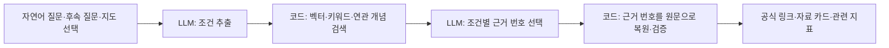

# 데이터이음 · Dataieum

**원본을 보관하지 않고, 의미로 연결한다.**

국내외 40개 포털의 공공데이터를 찾아 공식 출처까지 안내하는 AI Agent입니다. 전문지식이 없는 사용자도 해결하고 싶은 문제를 자연어로 입력하면, AI가 핵심 개념과 관련 지표를 도출하고 자료와 공식 경로를 연결합니다.

- **현재 서비스는 운영하지 않습니다.** 이 저장소는 프로젝트의 공개 소스 보존용입니다.
- **제4회 경남 AI·SW 경진대회 우수상 수상.** 참가 분야는 지역혁신·공공서비스 AI Agent입니다. [대회 공고](https://www.gnict.org/게시판/sw경진대회/제4회-경남aisw경진대회-공고/)
- 이전 서비스 주소: `dataieum.com`
- 기존 임베딩 DB는 삭제되었으며, 카탈로그 DB·임베딩 DB·벡터 인덱스는 저장소에 포함하지 않습니다.

## 배경과 문제

공공데이터의 양과 활용은 늘어났지만, 원하는 자료를 찾으려면 여전히 관련 지표와 기관별 검색어를 알아야 했습니다. 데이터이음은 이러한 탐색의 진입장벽을 낮추기 위해 개발했습니다.

| 배경 | 문제와 근거 |
| --- | --- |
| 공공데이터 활용 증가 | 2013년 말 대비 2024년 말 누적 다운로드·오픈API 활용 신청 약 **5,413배**, 개방 데이터 목록 약 **19배** 증가 |
| 도메인 지식 의존 | 비전문가는 문제 해결에 어떤 자료가 필요한지 판단하기 어렵고, 다른 분야의 연관 자료를 놓치기 쉬움 |
| LLM 검색의 출처 축약 | 비교 연구에서 답변당 평균 인용 URL은 LLM 검색 **4.3개**, 기존 검색 **10.3개**로 제시됨 |
| 질문 언어 편향 | 질문과 같은 언어의 자료를 우선 인용해 해외 공식 통계가 뒤로 밀리는 문제 |

목표는 **질문 언어나 출처의 유명세에 치우치지 않고, 뜻이 맞는 공식 자료를 찾아 공식 경로로 연결하는 것**입니다.

관련 통계·연구: 행정안전부 「공공데이터 개방 현황」(2024.12. 기준), O’Grady & Mangina(2025, *Universal Access in the Information Society*), Zhang et al.(2025, 6개 LLM 검색 엔진 비교), Sharma et al.(NAACL 2025, *Faux Polyglot*).

## 임베딩을 사용한 이유: 비교 실험에서 가설로

초기에는 태그 대응 규칙과 BM25를 사용했습니다. 하지만 같은 단어가 다른 뜻으로 쓰이는 경우와, 다른 단어로 같은 뜻을 표현하는 경우를 구별하는 데 한계가 있었습니다. 이를 확인하기 위해 운영 데이터의 무작위 표본을 서비스와 같은 **101개 주제 정의**에 분류해 비교했습니다.

| 비교 항목 | BM25 | 임베딩 |
| --- | ---: | ---: |
| 분류 불가 비율 | 6.8% | 0.1% |
| 두 방법의 답이 갈린 자료에 대한 정답률 | 19% | 62% |

BM25에서 분류하지 못한 자료는 주제 정의와 겹치는 단어가 없었습니다. 중국어·일본어 자료의 BM25 분류 불가 비율은 **97.3%**였습니다. 답이 갈린 자료는 어느 방법의 결과인지 가린 상태로 판정했습니다. 따라서 62%와 19%는 **불일치 자료에 대한 블라인드 판정 결과**이며, 전체 자료의 검색 정확도를 뜻하지 않습니다.

이 실험을 바탕으로 세운 가설은 다음과 같습니다.

> 공공기관이 작성한 제목·설명·공식 태그를 자료 의미의 1차 근거로 삼고, 이를 다국어 임베딩해 주제 정의·질문과의 의미 거리를 비교하면 언어가 달라도 분류하고 찾을 수 있다.

이 가설을 **입력이 충분한가, 작은 모델로 충분한가, 유사도로 나눌 수 있는가**라는 세 전제로 나누어 검증했습니다.

### 검색·수집 원칙

- **보관하지 않고 연결합니다.** 원본 데이터 파일 대신 메타데이터와 공식 페이지·다운로드 경로를 저장합니다.
- **공식 자료 1건을 1항목으로 셉니다.** API 기능이나 응답 필드로 자료 건수를 부풀리지 않습니다.
- **정확한 조건은 필터로 처리합니다.** 연도·지역·기관은 의미 유사도만으로 판단하지 않습니다.
- **자연어로 수요를 해석합니다.** 사용자가 해결하고 싶은 문제에서 핵심 개념과 관련 지표를 도출합니다.
- **규칙으로 확정되는 일은 코드가, 판단이 필요한 일은 LLM이 맡습니다.**
- 접속 실패만으로 자료가 사라졌다고 단정하지 않습니다.

## 입력 검증: 짧다고 버리지 않고 공식 문맥을 보완

전체 자료를 실제 토크나이저로 측정한 결과, 입력 길이는 **중앙값 97토큰, 평균 179토큰, 왜도 +1.61**로 치우쳐 있었습니다. 평균 길이만으로 판단하지 않고 백분위와 하위 구간을 살폈습니다.

짧은 자료를 사이트별로 직접 열람하고 일부를 원본 API와 대조하니, ‘산업별 취업자’처럼 **21토큰이어도 정상인 통계**가 있었습니다. 짧은 자료의 **69%가 KOSIS 통계표**였으며, 제목에서 생략된 의미가 공식 분류 경로에 담겨 있었습니다.

| 제공 방식 | 제목 | 문맥이 담긴 위치 |
| --- | --- | --- |
| 일반 포털 예시 | 고양시 산업별 취업자 | 설명: 고양시의 산업별 취업자 수를 집계한 통계 |
| KOSIS 예시 | 산업별 취업자 | 공식 분류: 고양시기본통계 > 노동 |

이에 따라 입력을 **제목 + 설명 + 공식 태그 + 공식 분류 경로**로 구성했습니다. 짧은 자료를 일괄 제거하는 대신, 제공기관이 이미 작성한 문맥을 함께 사용한 결정입니다.

- KOSIS의 **64토큰 이하 자료 비율: 99.3% → 0.5%**
- 전체 입력 길이의 **하위 5% 지점: 26토큰 → 32토큰**
- 길이 하위 5%를 잘랐다면 **KOSIS 자료의 51.5%를 잃었을 것**으로 분석

## 모델 선택: 우리 데이터의 성능과 반복 운영 비용

모델 선택 원칙은 세 가지였습니다.

1. 범용 평가 점수만으로 결정하지 않고 **실제 공공 메타데이터로 확인**합니다.
2. 한 번의 구축뿐 아니라 **매일 갱신해도 감당할 비용**을 고려합니다.
3. **서버 자원은 검색에 사용**하도록 구성합니다.

### 구축 당시 모델 비교

| 항목 | OpenAI text-embedding-3-small · 채택 | OpenAI text-embedding-3-large | BGE-M3 · 로컬 |
| --- | ---: | ---: | --- |
| 벡터 차원 | 1,536 | 3,072 | 1,024 |
| 전체 임베딩 비용·구축 조건 | $6.83 | 약 $44 | 별도 GPU 서버 |
| 벡터 원본 용량 | 23.3GB | 46.6GB | 15.6GB |
| Kor-IR NDCG@10 · 범용 평가 | 56.3 | 73.7 | 79.4 |

공공 메타데이터는 규격화된 행정·통계 용어를 중심으로 작성됩니다. 범용 평가에서 큰 모델이나 로컬 모델이 앞서더라도, 그 격차가 실제 대상 데이터에서도 나타나는지 확인하고 선택했습니다.

14개 출처의 표본에서 자료와 주제의 **평균 최고 유사도**를 확인했습니다.

| 출처 | 평균 최고 유사도 | 출처 | 평균 최고 유사도 |
| --- | ---: | --- | ---: |
| 한국 공공데이터포털 | 0.3853 | 영국 | 0.2894 |
| KOSIS | 0.3800 | 네덜란드 | 0.2888 |
| 오스트리아 | 0.3556 | 미국 | 0.2782 |
| 일본 | 0.3516 | 독일 | 0.2770 |
| 포르투갈 | 0.3276 | 프랑스 | 0.2751 |
| 대만 | 0.3181 | EU·다국어 | 0.2695 |
| 스페인 | 0.3106 | 호주 | 0.2657 |

이 값은 출처별 유사도 관찰 결과이며, 모델 간 정답률 비교나 정확도 백분율이 아닙니다.

KOSIS 입력 보완 결과를 통해 **모델 크기뿐 아니라 입력에 공식 문맥이 충분히 담겼는지가 중요하다**고 판단했습니다. 채택한 구성으로 **실측 입력 6.83억 토큰을 Batch API에서 약 28시간, $6.83**에 처리했습니다. 구축 당시 대형 모델 대비 비용은 약 1/6이었고, 일일 갱신에서는 변경된 자료만 다시 임베딩해 **기존 벡터 92% 재사용, 신규 비용 $0.018**을 기록했습니다.

## 온톨로지: 단어 대신 정의로 주제를 만들고 연결

**101개 소주제는 한국어·영어 사전식 정의로 임베딩**했습니다. 예를 들어 ‘예산·결산’은 단어를 나열하는 대신 다음과 같이 뜻을 설명했습니다.

- **한국어:** 예산·결산 — 일정 기간의 수입과 지출을 미리 정한 계획 및 그 집행 결과를 확정한 계산
- **영어:** Budget and Accounts — A planned statement of public revenue and expenditure and the final account of its execution

‘예산, 결산, budget…’처럼 키워드만 나열하면 단어가 같은 ‘Carbonate budget’까지 연결될 수 있어, ‘공공의 수입·지출’이라는 의미와 비교하도록 한 것입니다.

- **대주제 18개는 묶음 구조로만 사용:** 넓은 단어끼리 경계가 흐려지는 문제 때문에 대주제 자체는 임베딩하지 않았습니다.
- **계층과 연관을 구분:** 강수는 농업과 관련되지만 농업의 하위 개념은 아니라는 원칙을 적용했습니다(SKOS 참고).
- **주제와 자료 형식을 구분:** ‘통계·지도’는 주제와 구분해 형식으로 다루었습니다(DCAT 참고).

### 유사도 구간과 다중 연결 기준

전체 점수 분포와 구간별 표본 판독을 바탕으로 다음 구간을 정했습니다.

| 최고 유사도 | 분류 구간 | 운영 데이터 전체 비중 |
| --- | --- | ---: |
| 0.15 미만 | 미분류 | 0.1% |
| 0.15 이상, 0.25 미만 | 저신뢰 | 18.2% |
| 0.25 이상 | 고신뢰 | 81.7% |

여러 주제에 걸친 자료의 연결 기준은 **상대 비율 4가지 × 하한 3가지, 총 12개 조합**을 무작위 표본에 적용해 비교했습니다.

| 최고점 대비 연결 기준 | 자료당 평균 연결 주제 수 |
| --- | ---: |
| 80% | 4.18개 |
| 85% | 2.94개 |
| **90% · 채택** | **2.04개** |
| 95% | 1.40개 |

80% 기준에서는 자료의 **48%가 4개 이상 주제에 연결**돼 지도가 뭉개지는 문제가 있었습니다. 이에 최고점의 **90% 이상인 주제**를 연결하는 기준을 채택했습니다. 이 기준에서 자료당 평균 약 **2.0개 주제**가 연결되었습니다.

여기서 ‘고신뢰 81.7%’는 유사도 구간에 속하는 자료의 비율입니다. 정답률 81.7%를 뜻하지 않으며, 이를 정답 표본 기반 정확도로 보정하는 일은 발전 과제로 남겼습니다.

## AI Agent: LLM은 두 번 판단하고 나머지는 코드로

기본 검색 흐름은 다음과 같습니다.

LLM 호출은 **조건 추출과 근거 판정의 두 단계**에 사용했습니다. 국가·지역·연도·형식을 추출하고, 후보가 조건을 충족하는 근거를 고르도록 했습니다. 검색·정렬·필터·링크 확인은 코드가 처리하고, LLM은 설명이나 링크를 새로 만들어내기보다 제공된 근거를 선택하도록 구성했습니다.

### 별도 Vector DB 대신 FAISS 내장 인덱스

- IVF-PQ 압축으로 벡터 1개를 **6,144바이트 → 96바이트**, 약 **1/64**로 축소
- 전체 검색용 벡터를 **23.3GB → 약 0.4GB**로 줄여 앱 내부에서 검색
- 압축 인덱스로 후보를 찾은 뒤 **상위 후보는 저장된 원본 벡터로 점수를 다시 계산**
- 갱신 설계는 **하루 한 번 인덱스를 다시 만들어 카탈로그와 일치**시키는 방식

압축 크기는 검색용 인덱스에 관한 수치입니다. 최종 점수 재계산에는 원본 벡터를 사용합니다. ‘원본을 보관하지 않는다’는 원칙에서 원본은 **공공데이터 원본 파일**을 가리킵니다.

LLM이 생성한 링크는 사용하지 않고 **수집된 공식 경로만 제시**했습니다. LLM이 고른 근거 번호도 서버에서 해당 메타데이터 원문으로 복원해 검증했습니다.

## 사용 흐름: 질문과 지도, 공식 자료를 연결

**‘지구 온난화의 원인’**을 입력하면 질문의 개념과 공식 자료를 다음 순서로 연결합니다.

1. 사용자가 질문을 입력합니다.
2. LLM이 질문의 조건을 추출합니다.
3. 지도에서 질문과 연결된 **‘기후변화’ 개념을 금색으로 강조**합니다.
4. 근거를 확인한 자료 카드에서 공식 페이지로 이동합니다.
5. 함께 살펴볼 관련 자료·지표를 제시합니다.

화면에는 지도·목록·사이트 탐색, 자료명 검색, 사이트·개념·연도 필터, AI 채팅이 함께 배치되어 있습니다.

**‘경남 인구 통계’**를 찾은 뒤 **‘2020년만’**이라고 이어서 말하면, 나머지 검색 조건을 유지하면서 연도만 바꾸어 다시 검색할 수 있습니다.

## 공식 페이지 검증과 성과

자료 정리 과정에서는 **접속 실패나 LLM의 판정만으로 삭제하지 않는 것**을 원칙으로 삼았습니다.

| 검사 단계 | 검사 범위와 처리 결과 |
| --- | --- |
| 공식 페이지 전수 접속 검사 | 100% |
| 화면만으로 판단하기 어려운 자료 대조 | 77.0%: 빈 본문·JS 페이지와 미국 자료를 공식 메타데이터로 대조 |
| 예외 재검사 | 1.5%: 기계 재검사 |
| 최종 판단 대상 | 0.89%: LLM 33%, 기계 67%로 나누어 판단 |
| 최종 삭제 | 0.67%: 공식 목록 부재를 재확인하고 대체 경로도 없는 경우 |

LLM이 검토한 메타데이터 동일성 판정 결과는 **같은 의미 62.7%, 연도·범위 차이 35.2%, 다른 주제 1.5%, 근거 부족 0.6%**였습니다. 연도·범위 차이나 다른 주제로 판단된 자료는 바로 삭제하지 않고 교정 후보로 보존했습니다.

### 운영 당시 성과

| 항목 | 결과 |
| --- | --- |
| 통합 검색 대상 | 국내외 공식 포털 40개 |
| 자료–주제 연결 고신뢰 구간 | 전체 자료의 81.7% |
| 자료당 평균 연결 주제 | 약 2.0개 |
| 일일 갱신 시 기존 벡터 재사용 | 92% |
| 일일 갱신 신규 임베딩 비용 | $0.018 |
| 배포 전 자동화 검증 | 137개 테스트 통과 후 배포 |

## 한계와 향후 과제

### 남은 과제

- 유사도 기반 신뢰 구간을 **정답 표본 기반 정확도 지표**로 고도화
- EU·호주 자료 비중이 높은 천문·지질·역사 등 **주제표가 얇은 영역의 소주제 보강**
- 메타데이터 기반 안내의 한계: **실제 수치와 최신성은 연결된 공식 출처에서 확인**
- **경상남도·시군 포털은 당시 수집 대상에 미포함**

### 확장 방향

1. **경남 특화:** 경상남도와 18개 시군 포털을 연계해 도정 업무용 ‘정책 근거자료 찾기’ 제공
2. **정확도 보정:** 판정 표본으로 신뢰 구간을 보정하고, 유사도 0.2 미만 자료인 전체의 2.3%를 군집화해 약한 주제 보강
3. **Agent 확장:** MCP·API로 공개해 다른 AI Agent가 공공데이터 검색 도구로 활용

## 기술 스택과 데이터

- AI·개발 도구: `text-embedding-3-small`, `gpt-5.6-luna`, Codex, Claude Code
- 구성 기술: LangGraph, FAISS, PostgreSQL, React
- 데이터: 국내외 40개 공공데이터 포털의 공개 메타데이터
